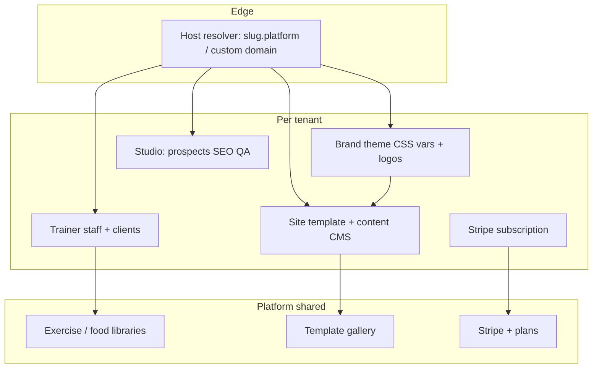

# Trainer SaaS Platform (ECShape = Tenant #1)

## Product north star

Build a **generic multi-trainer platform**. ECShape / Elior remains a **private seeded tenant** (case study), not the product identity.

Paying trainers get monthly:

- A **fully animated, personalizable marketing site** in the Kinetic Editorial / motionsites spirit (multiple templates, deep theming)
- A **complete trainer + trainee coaching product** (workouts, meals, check-ins, chat, supervision) already largely built in this repo
- Later: the same coach↔client dynamic for other disciplines (nutritionists, physios, etc.) via a discipline plugin layer — **after** fitness SaaS is solid

Working internal name: **Platform**. Public marketing name can be decided separately; code uses tenant brand, never hardcodes ECShape as the only brand.

## What exists today (baseline)

- **Strong coaching core**: roles `ADMIN` / `TRAINER` / `CLIENT`, `User.trainer_id`, workouts/meals V2–V3, check-ins, progress, chat, trainer/trainee shells
- **Strong single-brand site**: [`Frontend/src/site/`](Frontend/src/site/) — GSAP/Lenis Kinetic Editorial, section layout, Studio WYSIWYG ([`MySitePage.tsx`](Frontend/src/pages/studio/MySitePage.tsx)), content merge via [`SiteSetting`](app/models/studio.py)
- **Gaps**: no `Tenant`/org; studio settings & leads are **global**; CSS/tokens/logo/agent copy hardwired to ECShape; **no Stripe**; trainers created by admin; some APIs leak cross-trainer data; **one** site template

## Target architecture

**Core model**

- `Tenant` (`id`, `slug`, `name`, `status`, `discipline` default `fitness`)
- Membership: owner trainer(s) + clients scoped by `tenant_id` (keep `trainer_id` for coach assignment inside tenant)
- Scope today-global rows: `SiteSetting`, `Lead`, `QaTicket`, SEO, brand JSON → all get `tenant_id`
- Resolve tenant from `Host` header (subdomain) or custom-domain table; inject brand CSS vars + logo into site + portal shells
- Site = `template_id` + `theme` (palette, fonts, banner variants) + per-lang content (existing merge model)
- Billing = Stripe Customer + Subscription on tenant; gate studio publish + client seats by plan

**Site personalization (Shopify-depth, phased)**

- Templates: start with **Kinetic Editorial** (current ECShape site extracted as `template.kinetic-editorial`), then add 2–3 more motion templates (editorial light, dark athletic, soft wellness) inspired by motionsites / recent.design patterns — original code, shared motion vocabulary from [`.claude/skills/ecshape-motion/SKILL.md`](.claude/skills/ecshape-motion/SKILL.md)
- Theme: accent / surface / ink / gold, fonts, logo, favicon, login hero, agent display name
- Content: existing path-based CMS + section hide/reorder; later banner/media illustration variants per section
- Portal shells ([`TrainerShell`](Frontend/src/features/trainer/TrainerShell.tsx), [`TraineeShell`](Frontend/src/features/trainee/TraineeShell.tsx)): white-label wordmark + accent from tenant theme

**Discipline generalization (explicitly later)**

- Keep fitness domain models; add `discipline` on tenant and feature flags. Do not abstract workouts/meals until 2+ paying fitness tenants are live.

## Execution contract (for later Claude prompts)

Work **only by the steps below, in order**. After each step:

1. Implement the step’s scope (no scope creep into later steps)
2. Run / perform the **A2A scenarios** listed for that step (API + UI acceptance; Docker-only: `docker-compose`)
3. Record pass/fail; **do not start the next step until all scenarios for the current step pass**
4. Prefer extending existing studio/site/coaching code over rewrites

A2A = full acceptance scenarios (happy path + isolation/security) that prove the step is done for a later agent or human QA.

---

## Step 1 — Tenant foundation + ECShape seed

**Goal:** Introduce `Tenant`, attach users and global studio rows to a tenant; seed ECShape as tenant #1 so current product behavior is unchanged.

**Work**

- Add `tenants` table + `tenant_id` on `users`, `studio_site_settings` (composite key or scoped keys), `studio_leads`, `studio_qa_tickets`
- Migration / bootstrap: create tenant `ecshape`, backfill all existing rows
- Resolve tenant in request context (JWT claim + default ecshape for single-host until Step 4)
- Lock down known leaky list endpoints (all-users, public registered-users) to tenant scope

**A2A scenarios**

- A1.1 Fresh DB boot creates tenant `ecshape`; existing login (trainer + client) still works
- A1.2 Trainer A only sees clients with same `tenant_id` + their `trainer_id`
- A1.3 API that previously listed all users cannot return other-tenant users
- A1.4 Studio site content read/write only affects `ecshape` rows; second tenant row in DB is untouched

---

## Step 2 — Brand theme config (white-label tokens)

**Goal:** Per-tenant brand JSON drives CSS variables, logos, display name, agent name; ECShape keeps current look via seed.

**Work**

- Formalize `brand` setting: `{ displayName, logoUrl, faviconUrl, loginImageUrl, colors{bg,surface,ink,accent,gold}, fonts, agentName }`
- Inject CSS vars on public site (`.ec-site` / template root) and portal (`index.css` hooks)
- Replace hardcoded ECSHAPE / Elior strings in shells, login footer, `render.ts` logo label with brand fields
- Keep Agent EC prompt brand bits driven by tenant brand (minimal change in [`agent_ec.py`](app/services/agent_ec.py))

**A2A scenarios**

- A2.1 ECShape seed renders identical accent `#f0661f` and name ECSHAPE on site + portal
- A2.2 Changing tenant accent + displayName in DB/API updates site hero CTA color and portal wordmark without rebuild
- A2.3 Login page shows tenant logo/name, not hardcoded Elior-only copy when brand overridden
- A2.4 Agent system prompt uses tenant `agentName` / coach display name

---

## Step 3 — Scope studio CMS + leads per tenant

**Goal:** Every trainer studio edits **their** site/leads/SEO/QA only.

**Work**

- All studio + public site loaders take `tenant_id` from context
- Public `/public/site` resolves tenant (default ecshape until host routing)
- Prospect forms write `Lead` with `tenant_id`
- Trainer signup later will create empty site settings from template defaults

**A2A scenarios**

- A3.1 Two tenants in DB: publish content on T1; public site for T1 shows it; T2 public payload unchanged
- A3.2 Lead from T1 form never appears in T2 prospects list
- A3.3 Trainer on T2 cannot PUT T1 SEO via API (403)

---

## Step 4 — Host routing (subdomain + custom domain)

**Goal:** `ecshape.platform-host` and later custom domains resolve the correct tenant.

**Work**

- `TenantDomain` (`host`, `tenant_id`, primary flag)
- Middleware: resolve tenant from Host; CORS allowlist becomes dynamic from domains
- Local Docker: map `ecshape.localhost` / `demo.localhost` via compose or docs
- Frontend: load public site + brand for resolved tenant

**A2A scenarios**

- A4.1 Request with Host A returns tenant A content/brand; Host B returns B
- A4.2 Unknown host → safe fallback or 404 (defined behavior), never mixed content
- A4.3 CORS: allowed only for registered tenant origins
- A4.4 Custom domain row for tenant works same as subdomain

---

## Step 5 — Trainer self-serve signup + Stripe monthly billing

**Goal:** Trainer pays monthly → tenant provisioned → studio + coaching unlocked.

**Work**

- Stripe Customer + Subscription; plans (e.g. starter / pro with client seat limits)
- Signup flow: create user + tenant + seed site from default template + Checkout / Customer Portal
- Webhooks: `active` / `past_due` / `canceled` → tenant status; gate publish + add-client
- Admin can still create tenants (ECShape) without Stripe for the private case

**A2A scenarios**

- A5.1 Signup → Stripe test Checkout → webhook → tenant `active`, trainer can log in
- A5.2 `canceled` / unpaid tenant cannot publish site or add clients (clear UI error)
- A5.3 Customer Portal updates payment method; status stays active
- A5.4 ECShape tenant remains active without Stripe (admin-flagged `billing_exempt`)

---

## Step 6 — Extract Kinetic Editorial as Template #1 + theme studio UI

**Goal:** Current site becomes a selectable template; Studio gains palette / logo / template picker (not only copy editing).

**Work**

- Split [`render.ts`](Frontend/src/site/render.ts) / [`site.css`](Frontend/src/site/site.css) / [`siteMotion.js`](Frontend/src/site/siteMotion.js) behind `templates/kinetic-editorial/`
- `tenant.site.template_id = kinetic-editorial`
- Studio UI: brand colors, logo upload, preview; keep existing WYSIWYG content editor
- Content defaults become template defaults, not ECShape-person copy (ECShape person copy stays in tenant seed)

**A2A scenarios**

- A6.1 ECShape still matches current animated site (pins, marquee, reduced-motion off-path)
- A6.2 New tenant on kinetic-editorial sees generic fitness placeholder copy, not Elior testimonials
- A6.3 Palette change in Studio live-previews in iframe editor
- A6.4 `prefers-reduced-motion` and mobile ≤900px rules still hold (no pins)

---

## Step 7 — Multi-template gallery (2–3 additional motion templates)

**Goal:** Trainers choose among multiple fully animated, original templates (motionsites-class presence).

**Work**

- Add templates (names indicative): `athletic-dark`, `editorial-light`, `wellness-soft` — each with own CSS + motion init sharing the motion vocabulary skill
- Template gallery in Studio: thumbnails, switch template, confirm content mapping for shared section keys where possible
- Section schema stays shared (`hero`, `programs`, …) so content largely ports; template-specific blocks optional

**A2A scenarios**

- A7.1 Switching template changes layout/motion; brand colors still apply
- A7.2 Each template: hero + CTA + at least one signature scroll moment; reduced-motion safe
- A7.3 RTL (he) and LTR (en) both layout-correct per template
- A7.4 Publish after switch serves new template on public host

---

## Step 8 — Deep personalization (banners, media, illustration variants)

**Goal:** Shopify-like range: banner types, media treatments, illustration/style presets per section.

**Work**

- Per-section variant enums (e.g. hero: `fullBleedPin` | `split` | `minimal`; results: `hScroll` | `grid`)
- Media library per tenant; illustration presets / overlays
- Inspector UI for variant + media without code edits

**A2A scenarios**

- A8.1 Change hero variant → public site structure changes; content text retained
- A8.2 Replace media via library; old URL not shown after publish
- A8.3 Invalid variant rejected by API schema
- A8.4 Trainee/trainer portals unaffected by marketing variants

---

## Step 9 — Coaching product polish as multi-tenant SaaS

**Goal:** Full trainer supervision + trainee gym-app-plus-human-coach experience is tenant-safe and branded.

**Work**

- Audit all routers for `tenant_id` enforcement (workouts, meals, chat, files, WS)
- White-label trainee app chrome; trainer multi-client dashboard unchanged functionally
- Seat limits from plan; optional client self-serve invite link scoped to tenant
- Harden file/avatar URLs to tenant

**A2A scenarios**

- A9.1 Trainer manages 2+ clients: plans, meals, check-ins, chat — all isolated to tenant
- A9.2 Client app: Today / Training / Meals / Progress / Coach complete flows on mobile viewport
- A9.3 Client of T1 cannot open T2 plan IDs (403)
- A9.4 Seat limit blocks add-client with clear message; raising plan allows it
- A9.5 WS/chat messages never cross tenants

---

## Step 10 — Platform marketing site + ops (launch readiness)

**Goal:** Sell the platform (not only tenant sites).

**Work**

- Platform landing (separate from tenant templates): pricing, template gallery demos, signup CTA
- Admin ops: list tenants, impersonate support (audited), billing status
- Metrics: active subscriptions, churn basics
- Docs for custom domain DNS

**A2A scenarios**

- A10.1 Platform landing signup starts Step 5 flow
- A10.2 Admin sees tenants + billing status; cannot access without ADMIN
- A10.3 Demo template previews do not mutate ECShape production content

---

## Step 11 — Discipline-ready hooks (later, explicit defer)

**Goal:** Prepare generalization without rewriting fitness.

**Work**

- `tenant.discipline`, feature flags (`meals`, `workouts`, `sessions`)
- Rename user-facing “trainer/trainee” via i18n packs per discipline later
- No domain model split until a second discipline is scheduled

**A2A scenarios**

- A11.1 `fitness` tenant: all flags on; app identical
- A11.2 Flag-off `meals` hides meal nav for that tenant only
- A11.3 ECShape seed remains full fitness

---

## Implementation priorities inside each step

- Docker-only workflows; no host npm/pip
- i18n for all new UI (he/en at minimum); RTL logical properties
- ECShape private case: `billing_exempt` + full content seed so Elior’s product never regresses
- Prefer tenant-scoped extensions of [`SiteSetting`](app/models/studio.py) and existing Studio editor over a new CMS

## Out of scope until after Step 10

- Marketplace of third-party templates
- Native mobile apps
- Non-fitness discipline full builds
- Rewriting coaching domain into generic “programs/sessions” ontology