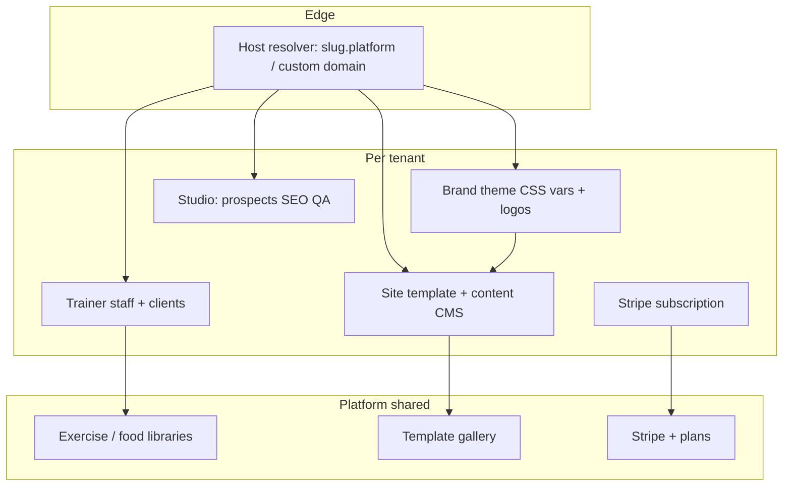

# Trainer SaaS Platform (ECShape = Tenant #1)

## Product north star

Build a **generic multi-trainer platform**. ECShape / Elior remains a **private seeded tenant** (case study), not the product identity.

Paying trainers get monthly:

- A **fully animated, personalizable marketing site** at a **cinematic / motion-design bar** drawn from **many** top inspiration sources (not one feed) — the wedge **neither Perform nor NutriCal owns**
- A **complete trainer + trainee coaching product** that feels **simpler to use** than Israeli CRM/coach suites, but is **more complete and better** where brand + coaching craft matter
- Later: the same coach↔client dynamic for other disciplines — **after** fitness SaaS is solid
- Assume **100%**: if we win on product, **Perform** and **NutriCal** will copy features and fight to keep clients — defensibility is planned, not hoped for

Working internal name: **Platform**. Public marketing name TBD; code uses tenant brand, never hardcodes ECShape as the only brand.

**Dual mandate for every later Claude prompt:**
1. **Coaching / SaaS UX:** study **Perform** and **NutriCal**, then ship fewer taps + deeper brand/coaching — no CRM clone.
2. **Website / template design:** always build from a **multi-source inspiration brief** (see Design inspiration pool below) — full inspiration, original implementation; never a generic SaaS/Bootstrap landing.

---

## Competitors Claude must know by name

### 1) Perform (ByPerform / AutoFit) — primary “full stack coach OS” rival

**Canonical names:** **Perform**, **ByPerform**, **Perform מבית AutoFit**, parent **AutoFit**.

- Product app: [https://app.byperform.co.il/](https://app.byperform.co.il/) (also deep-linked landing sections like `#lp-tech`)
- Parent marketing: [https://auto-fit.co.il/](https://auto-fit.co.il/)
- Launch write-up: [Perform מבית AutoFit](https://auto-fit.co.il/blog/autofit-perform-new-system.html)
- Positioning: branded client app in ~5 minutes (logo + color), AI agent that opens **team tasks** when clients drift, self-building task board, workouts + nutrition, smart forms, lock-screen / Dynamic Island workout UX, branded Instagram story share after workouts. AutoFit heritage also sells heavy CRM (telephony, email marketing, WhatsApp AI, studio classes, billing). Market signal ~₪300/mo up to ~25 clients + ~30-day trial.
- Client install model: trainees download an app named **Perform**, then see the trainer’s skin — white-label *inside* someone else’s store brand.

**Do not confuse** with unrelated English SaaS “Perform” (prfrm.app). Our competitor is Israeli **ByPerform / AutoFit Perform**.

**What Perform gets right (steal the job, not the clutter):** time-to-value; retention AI → actionable tasks; unified client card; post-workout share growth loop; template → personalize plans in one click.

### 2) NutriCal (נוטריקל / NutriCloud) — primary “nutrition + coaching app” rival

**Canonical names:** **NutriCal**, **נוטריקל**, company **NUTRICLOUD LTD** / **NutriCloud**.

- Marketing / product: [https://nutricloudpro.com/](https://nutricloudpro.com/)
- Trainer admin: [https://admin.nutricloudpro.com/](https://admin.nutricloudpro.com/)
- Instagram (user-linked): [https://www.instagram.com/nutrical_il](https://www.instagram.com/nutrical_il)
- Positioning: Hebrew-first management system for PTs **and nutritionists** — Israeli food database (10k+ products), meal templates + swaps, workouts with demo video, branded client mobile app, progress (weight/measures/photos), scheduling, WhatsApp automations (e.g. Upgrade360), Arbox studio sync, open API (Zapier/Make/n8n), meal photo / label AI logging. Pricing signal from ~₪75/mo with free trial month; claims hundreds of coaches / tens of thousands of clients.
- Client install model: store apps named **NutriCal** with trainer branding inside.

**What NutriCal gets right:** Israeli food realism; meal logging AI; dual audience (trainer + nutritionist); “build menu in 5 minutes”; progressive overload / workout player polish; integrations that keep the coach in WhatsApp/Arbox workflows.

### Competitive wedge (how we are simpler AND better)

- **Public brand site:** Perform and NutriCal optimize the *client app skin*. We win with **motionsites-class multi-template sites**, Shopify-depth personalization, custom domain, SEO/blog/leads — already started in Studio.
- **Brand ownership:** their clients open apps named **Perform** or **NutriCal**. Ours open the **trainer’s domain + PWA**; platform name stays invisible.
- **UX density:** AutoFit/NutriCal path → more modules, more admin. We use **progressive disclosure**: 3 daily trainer jobs on Pulse; power tools one click deeper. Simple surfaces, complex systems underneath.
- **Coaching craft:** match their coverage (workouts + meals + progress + chat) but make assign / adapt / supervise feel faster than NutriCal admin sprawl and clearer than Perform CRM.
- **Nutrition:** do not ignore NutriCal — deepen meal V3 + Israeli food usefulness + easy swaps/logging; avoid becoming a food-CMS encyclopedia UI on day one.
- **AI:** Perform-style retention → our **Coach Pulse**; Studio Agent for site/content; no enterprise WhatsApp telephony bot in v1.
- **Onboarding:** ≤5 min: template → logo/colors → publish **site** → invite first client (beats “app skin only”).
- **Integrations:** defer Arbox/Upgrade360 clones until after Step 10; win on product completeness first.
- **Native store white-label:** PWA first; native binaries only if PWA loses retention to Perform/NutriCal store apps.

### Product principles (binding for later Claude prompts)

1. **Simple to use, complex underneath** — every capability has a one-screen happy path; advanced options behind “More” / inspector, never on the home path.
2. **Three trainer jobs only on the home Pulse:** (a) who needs me today, (b) what to publish / sell, (c) what to build next for a client. Everything else is secondary nav.
3. **Beat Perform + NutriCal on brand gravity** — marketing site + SEO + leads + app chrome are one brand system.
4. **Do not clone AutoFit CRM or NutriCal integration sprawl in v1** — no telephony, email blasts, class-pack POS, Arbox/Upgrade360 until after Step 10 + explicit demand.
5. **Design test (every screen):** “Would a Perform or NutriCal user find this clearer in under 10 seconds, and would they notice we go deeper on brand or coaching?” If neither, redesign.
6. **Hebrew-first trainer UX** with full EN (and existing FR site langs) — same market as Perform and NutriCal.
7. **When stuck on coaching UX:** re-open **Perform** (app.byperform.co.il / AutoFit) and **NutriCal** (nutricloudpro.com / @nutrical_il) — copy the *job-to-be-done*, not their IA.
8. **When stuck on website design:** pull from **several** sources in the inspiration pool below — never invent a “safe startup landing” that fails the cinematic / editorial bar.
9. **Assume copycats** — ship features as part of a compounding system (site ↔ leads ↔ coaching ↔ Pulse ↔ share), not as isolated checklist items competitors can paste.

---

## Website design inspiration pool (binding — multi-source, not one feed)

**Do not rely on a single source.** [@viktoroddy](https://www.threads.com/@viktoroddy) / MotionSites is one strong **example** in the pool, not the only allowed bar. Every template/section brief should cite **at least 2–3 different sources** (different sites or libraries), for **full inspiration** → original implementation in our GSAP/Lenis stack (no scraping proprietary assets/code).

### Core pool (always eligible; expand over time)

**Motion / cinematic web**
- [https://www.threads.com/@viktoroddy](https://www.threads.com/@viktoroddy) — Viktor Oddy drops & linked prompts (example curator, not sole canon)
- [https://motionsites.ai/](https://motionsites.ai/) — animated / 3D / scroll-driven prompt library
- [https://studio.motionsites.ai/](https://studio.motionsites.ai/) — restyle / make-it-yours patterns
- Awwwards / FWA site-of-the-day class work; scrolltide.co, jiro.build–class scroll templates (inspiration only)
- Other strong motion/3D landing curators and studios as the agent finds them — add links into the template `DESIGN.md`

**Editorial / brand / launch craft**
- [https://recent.design/](https://recent.design/) — OG images, icons, launch videos, polished launch surfaces
- [https://brandguidelines.net/](https://brandguidelines.net/) — identities and design systems (token discipline, type, logo systems)
- [https://deck.gallery/](https://deck.gallery/) — pitch-deck clarity hierarchy (useful for programs/pricing sections, not for copying slide chrome)

**Galleries / references (use freely)**
- Land-book, Landdding, Godly, Minimal.Gallery, Refero, Mobbin (for mobile coaching chrome only — keep marketing site cinematic)
- High-end fitness / wellness / coaching brand sites when relevant to a template mood

**In-repo craft**
- Existing Kinetic Editorial + [`.claude/skills/ecshape-motion/SKILL.md`](.claude/skills/ecshape-motion/SKILL.md) — motion vocabulary, RTL, reduced-motion

### Rules for Steps 6–8, 10 (and any future template work)

1. Before designing a template / section / hero / motion moment: open **multiple** pool sources, extract composition, motion, type, media, scroll attitude — then implement **original** code.
2. Every new template must feel cinematic / personally branded / gallery-worthy — not Bootstrap, not default Shopify, not generic AI purple SaaS.
3. Personalization (colors, media, banners, copy) is first-class — “restyle with my brand in minutes” is the UX bar (MotionSites Studio is one reference for that *feeling*, not the only one).
4. Keep Hebrew/RTL + reduced-motion rules from the ecshape-motion skill.
5. Each template gets `DESIGN.md` listing **≥2–3 distinct inspiration links** (different origins) so later agents don’t collapse to one aesthetic.
6. Rotate sources across templates so the gallery doesn’t all look like one curator’s feed — diversity is part of the product (Shopify-like choice) and part of the moat (harder to clone one look).

---

## Defensibility: they will copy us — plan for it

**Premise:** Feature parity is temporary. Perform/NutriCal have distribution, sales, and existing coach bases. If our wedge works, they will add “animated site” / “Pulse” / “share cards” and discount to retain. Winning = **hard-to-copy compound system + switching costs + velocity**, not a longer feature list.

### What is NOT a moat

- Any single screen or feature (Pulse, share card, one template, AI meal log)
- “Nicer UI” alone (they can hire or ship a thinner clone)
- Patents on coach-app UX (unreliable here)

### Moats we deliberately build

1. **Owned brand gravity (hardest for them to fake overnight)**  
   Trainer’s **custom domain + SEO/blog + lead forms + cinematic site** is their public business, not a skin inside Perform/NutriCal. Leaving us means re-homing their web identity. Continuously refresh templates from the **multi-source inspiration pool** so clones always look one generation behind.

2. **Compound loop, not features**  
   Site → lead → convert → plan → Pulse → share → new lead. Copying one node doesn’t copy the loop. Every step in the plan should strengthen an edge of this loop (Steps 3, 5, 6–8, 9b, 9c).

3. **Switching costs that feel fair**  
   Deep history: workouts, meals, check-ins, chat, progress photos, published site content. Offer **export** (trust) but make day-to-day operation so smooth that export is for peace of mind, not an exit ramp. Migration *into* us is free/assisted (steal their playbook).

4. **Trainee habit on the trainer’s PWA**  
   Daily Today / Training / Meals on **trainer-branded** home-screen app. Competitors’ store apps keep *their* brand in the App Store; our stickiness sits on the trainer’s relationship + daily ritual.

5. **Design velocity as a product**  
   Cadence: new multi-source-inspired template or major section variant on a fixed rhythm (e.g. monthly). Competitors can copy last month’s look; they can’t easily staff a continuous cinematic template machine. Codify this as an ops habit after Step 7.

6. **Data + taste in fitness coaching**  
   Polish meal V3 / workout V2 / supervision card beyond checklist parity. Taste and workflow depth copy slower than screenshots.

7. **Commercial retention (honest, not dark)**  
   Annual plans with clear savings; win-back offers; “keep your domain + site live” as the emotional lock-in. Avoid hostage tactics (no blocking data export) — hostage brands lose Hebrew-market trust.

8. **Narrative moat**  
   Public positioning: “Your name on the site and the app — not Perform, not NutriCal.” ECShape as living proof. Case studies of trainers who own their domain.

### When they ship a clone — playbook

- Do **not** panic-ship AutoFit CRM modules to “match”
- Ship the **next** cinematic-tier template (new mix of inspiration sources) + tighten the compound loop
- Double down on onboarding migration (import clients/plans) and Pulse quality
- Communicate to trainers: site + domain + SEO are assets that stay with them on our platform
- Measure: time-to-first-publish, trainee weekly active, lead→client conversion — if those win, feature copy fails

### Implications for later Claude prompts

- Prefer work that deepens moats 1–6 over one-off feature demos
- Never treat “parity with Perform/NutriCal” as a goal; treat “harder to leave + fresher brand” as the goal
- Template work must cite **≥2–3** inspiration-pool links (varied sources) in the PR/step notes

## What exists today (baseline)

- **Strong coaching core**: roles `ADMIN` / `TRAINER` / `CLIENT`, `User.trainer_id`, workouts/meals V2–V3, check-ins, progress, chat, trainer/trainee shells
- **Strong single-brand site**: [`Frontend/src/site/`](Frontend/src/site/) — GSAP/Lenis Kinetic Editorial, section layout, Studio WYSIWYG ([`MySitePage.tsx`](Frontend/src/pages/studio/MySitePage.tsx)), content merge via [`SiteSetting`](app/models/studio.py)
- **Gaps**: no `Tenant`/org; studio settings & leads are **global**; CSS/tokens/logo/agent copy hardwired to ECShape; **no Stripe**; trainers created by admin; some APIs leak cross-trainer data; **one** site template

## Target architecture

**Core model**

- `Tenant` (`id`, `slug`, `name`, `status`, `discipline` default `fitness`)
- Membership: owner trainer(s) + clients scoped by `tenant_id` (keep `trainer_id` for coach assignment inside tenant)
- Scope today-global rows: `SiteSetting`, `Lead`, `QaTicket`, SEO, brand JSON → all get `tenant_id`
- Resolve tenant from `Host` header (subdomain) or custom-domain table; inject brand CSS vars + logo into site + portal shells
- Site = `template_id` + `theme` (palette, fonts, banner variants) + per-lang content (existing merge model)
- Billing = Stripe Customer + Subscription on tenant; gate studio publish + client seats by plan

**Site personalization (Shopify-depth + multi-source cinematic bar, phased)**

- Templates: start with **Kinetic Editorial** (`template.kinetic-editorial`), then add more templates whose briefs always pull from **several** inspiration-pool sources — original code, shared motion vocabulary from [`.claude/skills/ecshape-motion/SKILL.md`](.claude/skills/ecshape-motion/SKILL.md)
- Theme: accent / surface / ink / gold, fonts, logo, favicon, login hero, agent display name (instant restyle-with-brand UX)
- Content: existing path-based CMS + section hide/reorder; later banner/media illustration variants per section
- Portal shells ([`TrainerShell`](Frontend/src/features/trainer/TrainerShell.tsx), [`TraineeShell`](Frontend/src/features/trainee/TraineeShell.tsx)): white-label wordmark + accent from tenant theme

**Discipline generalization (explicitly later)**

- Keep fitness domain models; add `discipline` on tenant and feature flags. Do not abstract workouts/meals until 2+ paying fitness tenants are live.

## Execution contract (for later Claude prompts)

Work **only by the steps below, in order**. After each step:

1. Implement the step’s scope (no scope creep into later steps)
2. Re-check competitor notes by name — **Perform (ByPerform / AutoFit, app.byperform.co.il)** and **NutriCal (נוטריקל / NutriCloud, nutricloudpro.com, Instagram nutrical_il)** — do not ship a denser clone of their CRM/admin
3. For any website/template/visual work: build a brief from **≥2–3 sources** in the multi-source inspiration pool (Viktor/MotionSites is fine as *one* of them, never the only one); cite links in the step notes
4. Ask: does this deepen a **moat** (owned site, compound loop, trainee habit, design velocity) or only a copyable checklist item? Prefer moat.
5. Run / perform the **A2A scenarios** listed for that step (API + UI acceptance; Docker-only: `docker-compose`)
6. Record pass/fail; **do not start the next step until all scenarios for the current step pass**
7. Prefer extending existing studio/site/coaching code over rewrites
8. For UI steps: prefer fewer controls on the primary path; put power under progressive disclosure

A2A = full acceptance scenarios (happy path + isolation/security + “simpler than Perform/NutriCal for the same job” + cinematic multi-source design bar where relevant) that prove the step is done for a later agent or human QA.

---

## Step 1 — Tenant foundation + ECShape seed

**Goal:** Introduce `Tenant`, attach users and global studio rows to a tenant; seed ECShape as tenant #1 so current product behavior is unchanged.

**Work**

- Add `tenants` table + `tenant_id` on `users`, `studio_site_settings` (composite key or scoped keys), `studio_leads`, `studio_qa_tickets`
- Migration / bootstrap: create tenant `ecshape`, backfill all existing rows
- Resolve tenant in request context (JWT claim + default ecshape for single-host until Step 4)
- Lock down known leaky list endpoints (all-users, public registered-users) to tenant scope

**A2A scenarios**

- A1.1 Fresh DB boot creates tenant `ecshape`; existing login (trainer + client) still works
- A1.2 Trainer A only sees clients with same `tenant_id` + their `trainer_id`
- A1.3 API that previously listed all users cannot return other-tenant users
- A1.4 Studio site content read/write only affects `ecshape` rows; second tenant row in DB is untouched

---

## Step 2 — Brand theme config (white-label tokens)

**Goal:** Per-tenant brand JSON drives CSS variables, logos, display name, agent name; ECShape keeps current look via seed.

**Work**

- Formalize `brand` setting: `{ displayName, logoUrl, faviconUrl, loginImageUrl, colors{bg,surface,ink,accent,gold}, fonts, agentName }`
- Inject CSS vars on public site (`.ec-site` / template root) and portal (`index.css` hooks)
- Replace hardcoded ECSHAPE / Elior strings in shells, login footer, `render.ts` logo label with brand fields
- Keep Agent EC prompt brand bits driven by tenant brand (minimal change in [`agent_ec.py`](app/services/agent_ec.py))

**A2A scenarios**

- A2.1 ECShape seed renders identical accent `#f0661f` and name ECSHAPE on site + portal
- A2.2 Changing tenant accent + displayName in DB/API updates site hero CTA color and portal wordmark without rebuild
- A2.3 Login page shows tenant logo/name, not hardcoded Elior-only copy when brand overridden
- A2.4 Agent system prompt uses tenant `agentName` / coach display name

---

## Step 3 — Scope studio CMS + leads per tenant

**Goal:** Every trainer studio edits **their** site/leads/SEO/QA only.

**Work**

- All studio + public site loaders take `tenant_id` from context
- Public `/public/site` resolves tenant (default ecshape until host routing)
- Prospect forms write `Lead` with `tenant_id`
- Trainer signup later will create empty site settings from template defaults

**A2A scenarios**

- A3.1 Two tenants in DB: publish content on T1; public site for T1 shows it; T2 public payload unchanged
- A3.2 Lead from T1 form never appears in T2 prospects list
- A3.3 Trainer on T2 cannot PUT T1 SEO via API (403)

---

## Step 4 — Host routing (subdomain + custom domain)

**Goal:** `ecshape.platform-host` and later custom domains resolve the correct tenant.

**Work**

- `TenantDomain` (`host`, `tenant_id`, primary flag)
- Middleware: resolve tenant from Host; CORS allowlist becomes dynamic from domains
- Local Docker: map `ecshape.localhost` / `demo.localhost` via compose or docs
- Frontend: load public site + brand for resolved tenant

**A2A scenarios**

- A4.1 Request with Host A returns tenant A content/brand; Host B returns B
- A4.2 Unknown host → safe fallback or 404 (defined behavior), never mixed content
- A4.3 CORS: allowed only for registered tenant origins
- A4.4 Custom domain row for tenant works same as subdomain

---

## Step 5 — Trainer self-serve signup + Stripe + ≤5‑min guided onboarding

**Goal:** Trainer pays (or starts trial) → tenant provisioned → **guided “go live” wizard** that beats Perform’s “app skin in minutes” by also publishing a real marketing site.

**Work**

- Stripe Customer + Subscription; plans with client seat limits (price later; market anchors: Perform ~₪300/25 clients, NutriCal from ~₪75/mo — do not copy blindly; position on brand site + coaching depth, not race-to-bottom)
- Optional 14–30 day trial; webhook status machine: `active` / `past_due` / `canceled`
- **Onboarding wizard (one linear path, max ~5 screens):** (1) business name + slug, (2) logo + accent color, (3) pick 1 of N templates (even if only Kinetic exists yet), (4) publish site preview, (5) invite first client / copy invite link — no CRM setup, no telephony
- Admin can still create tenants (ECShape) with `billing_exempt`
- Empty states everywhere point back into this wizard until “first client + site published”

**A2A scenarios**

- A5.1 Signup → Stripe test Checkout (or trial) → webhook → tenant `active`, trainer can log in
- A5.2 New trainer completes wizard and has **public site live + invite link** without opening secondary settings pages
- A5.3 `canceled` / unpaid tenant cannot publish site or add clients (clear UI error)
- A5.4 Customer Portal updates payment method; status stays active
- A5.5 ECShape tenant remains active without Stripe (`billing_exempt`)
- A5.6 Wizard can be re-opened; never exposes AutoFit-style module sprawl on first run

---

## Step 6 — Extract Kinetic Editorial as Template #1 + theme studio UI

**Goal:** Current site becomes a selectable template; Studio gains palette / logo / template picker (not only copy editing). Instant restyle-with-brand UX.

**Work**

- Before UI polish: write `templates/kinetic-editorial/DESIGN.md` with **≥2–3** inspiration-pool links (mixed sources — e.g. one motion curator + recent.design / brand system + a gallery reference)
- Split [`render.ts`](Frontend/src/site/render.ts) / [`site.css`](Frontend/src/site/site.css) / [`siteMotion.js`](Frontend/src/site/siteMotion.js) behind `templates/kinetic-editorial/`
- `tenant.site.template_id = kinetic-editorial`
- Studio UI: brand colors, logo upload, preview; keep existing WYSIWYG content editor
- Content defaults become template defaults, not ECShape-person copy (ECShape person copy stays in tenant seed)

**A2A scenarios**

- A6.1 ECShape still matches current animated site (pins, marquee, reduced-motion off-path)
- A6.2 New tenant on kinetic-editorial sees generic fitness placeholder copy, not Elior testimonials
- A6.3 Palette change in Studio live-previews in iframe editor (instant restyle feel)
- A6.4 `prefers-reduced-motion` and mobile ≤900px rules still hold (no pins)
- A6.5 `DESIGN.md` cites ≥2–3 distinct inspiration sources (not a single feed)

---

## Step 7 — Multi-template gallery (2–3 additional motion templates)

**Goal:** Trainers choose among multiple fully animated, original templates at cinematic multi-source quality — design-velocity + aesthetic diversity moat vs Perform/NutriCal.

**Work**

- For each new template: brief from **≥2–3 different pool sources** (rotate so templates don’t all echo one curator) → original fitness-coach variants (`athletic-dark`, `editorial-light`, `wellness-soft` or better names from the brief)
- Each template: own CSS + motion init; shared motion vocabulary from ecshape-motion skill; `DESIGN.md` with source links
- Template gallery in Studio: thumbnails, switch template, content mapping for shared section keys
- Define **monthly template/variant cadence** ops note — copycats lag a diversified feed

**A2A scenarios**

- A7.1 Switching template changes layout/motion; brand colors still apply
- A7.2 Each template: hero + CTA + at least one signature scroll moment; reduced-motion safe; gallery-worthy cinematic bar
- A7.3 RTL (he) and LTR (en) both layout-correct per template
- A7.4 Publish after switch serves new template on public host
- A7.5 Each template `DESIGN.md` lists ≥2–3 sources; templates in the gallery are visibly different in mood (not one-source clones of each other)

---

## Step 8 — Deep personalization (banners, media, illustration variants)

**Goal:** Shopify-like restyle depth: banner types, media treatments, illustration/style presets per section — personalization competitors can’t screenshot-copy.

**Work**

- Per-section variant enums (e.g. hero: `fullBleedPin` | `split` | `minimal`; results: `hScroll` | `grid`) informed by patterns across the inspiration pool (heroes, scroll stories, interactive bands, editorial decks)
- Media library per tenant; illustration presets / overlays
- Inspector UI for variant + media without code edits

**A2A scenarios**

- A8.1 Change hero variant → public site structure changes; content text retained
- A8.2 Replace media via library; old URL not shown after publish
- A8.3 Invalid variant rejected by API schema
- A8.4 Trainee/trainer portals unaffected by marketing variants
- A8.5 Two tenants on same template look clearly different after only brand+media+variant changes (restyle bar)

---

## Step 9 — Coaching product polish as multi-tenant SaaS (+ PWA white-label)

**Goal:** Full trainer supervision + trainee “gym app with a human coach” is tenant-safe and branded — **without** requiring clients to download an app named **Perform** or **NutriCal** (their store-skin model).

**Work**

- Audit all routers for `tenant_id` enforcement (workouts, meals, chat, files, WS)
- White-label trainee + trainer chrome from brand tokens
- **Installable PWA** per tenant (manifest name/icons = trainer brand; `start_url` on tenant host)
- Seat limits from plan; client invite link scoped to tenant
- Harden file/avatar URLs to tenant
- Trainee IA stays the five tabs (Today / Training / Meals / Progress / Coach) — do not add Perform/NutriCal-like extra modules on the client home
- Trainer client profile = **one card**: adherence, nutrition, check-ins, chat jump — clearer than NutriCal admin depth and lighter than AutoFit CRM
- Workout player: rest timer + set logging must feel at least as fast as NutriCal’s praised in-workout UX (web/PWA; not Dynamic Island)

**A2A scenarios**

- A9.1 Trainer manages 2+ clients: plans, meals, check-ins, chat — all isolated to tenant
- A9.2 Client app: Today / Training / Meals / Progress / Coach complete flows on mobile viewport
- A9.3 Client of T1 cannot open T2 plan IDs (403)
- A9.4 Seat limit blocks add-client with clear message; raising plan allows it
- A9.5 WS/chat messages never cross tenants
- A9.6 “Add to Home Screen” PWA shows **trainer** name/icon, not platform / Perform / NutriCal
- A9.7 Cold client can start today’s workout in ≤3 taps from Today
- A9.8 Assign template workout + meal plan to a new client in ≤2 minutes (NutriCal “5 minutes” bar, we aim tighter on the happy path)

---

## Step 9b — Coach Pulse (retention AI → ranked next actions)

**Goal:** Match Perform’s “AI finds drifting clients and opens tasks” with a **simpler** surface: one Pulse list, not a full project-management suite.

**Work**

- Signals: days since last login, missed check-ins, meal-log drop, workout skip streak, unanswered chat
- Pulse home (trainer): ranked cards — client, why, suggested action (message / call note / rebuild plan), one-tap act
- Optional auto-create lightweight `Task` (assignee = trainer, due = today) — **no** multi-board Kanban in v1
- Extend existing Agent / notifications rather than a parallel AI product; reuse [`agent_ec.py`](app/services/agent_ec.py) patterns with tenant brand voice
- Mute / snooze per client to avoid alert fatigue (learn from Perform’s “not another buried notification” claim)

**A2A scenarios**

- A9b.1 Seeded “silent” client appears on Pulse within defined rules; healthy clients do not
- A9b.2 One tap from Pulse opens chat prefilled or plan builder for that client
- A9b.3 Completing / dismissing a Pulse item removes it; snooze hides until date
- A9b.4 Pulse never lists other-tenant clients
- A9b.5 New trainer understands Pulse purpose in under 10 seconds (copy + empty state) — qualitative gate

---

## Step 9c — Growth loops: share cards + lead→client one-flow

**Goal:** Beat / match Perform’s post-workout branded story share, and close the loop our site already starts (prospects → clients) with less friction than AutoFit CRM.

**Work**

- After workout complete: full-screen share card (story 9:16) with tenant logo/colors, PR or session summary; Web Share API + download image fallback
- Prospect (`Lead`) → “Convert to client” one action (creates CLIENT user, assigns trainer, optional invite SMS/WhatsApp link using tenant social settings)
- Keep Studio prospects list simple; no telephony recording / mail blasts

**A2A scenarios**

- A9c.1 Finish workout → share card shows tenant brand; platform name absent
- A9c.2 Share image downloads / native share sheet works on mobile Safari + Chrome Android
- A9c.3 Convert lead → client appears in clients list with trainer_id + tenant_id; lead status `converted`
- A9c.4 Converted client invite link opens branded login/PWA for that tenant only

---

## Step 9d — Nutrition depth (answer NutriCal without becoming NutriCal)

**Goal:** Close the gap vs **NutriCal** on Israeli-useful meals while keeping our meal UX simpler than their admin.

**Work**

- Audit existing meal V3 / food bank against NutriCal jobs: template menu → assign → client swaps → log day → trainer sees adherence
- Happy path: “duplicate template → assign client → client logs today’s meals” with minimal screens
- Food search must work for common Israeli products (expand catalog iteratively; quality > dumping 10k noisy rows)
- Optional later (post-9d if time): photo / label assist for logging — only if it stays one-tap; do not block Step 10 on matching NutriCal AI food scanner
- Trainer meal supervision surfaces on the same client card / Pulse signals (meal-log drop), not a separate nutrition CRM

**A2A scenarios**

- A9d.1 Trainer assigns a weekly meal plan from template in one flow; client sees it under Meals the same day
- A9d.2 Client can swap an allowed alternative without trainer intervention
- A9d.3 Client logs a meal; trainer client card shows adherence update
- A9d.4 Food search finds common Hebrew product names used in ECShape seed plans
- A9d.5 New trainer completes first meal assign without opening advanced food-bank editors (progressive disclosure)

---

## Step 10 — Platform marketing site + ops (launch readiness)

**Goal:** Sell the platform (not only tenant sites) with a clear wedge **versus Perform and NutriCal**, and operationalize **copy-defense** (velocity + switching costs + narrative).

**Work**

- Platform landing: multi-source cinematic brief (not CRM brochure). Hero = “Your brand. Your site. Your app.”
- Competitive framing (optional): they skin a **store app named after them**; we give **real website + owned PWA + coaching**
- Public copy: benefit language; internal briefs name Perform / NutriCal
- Admin ops: tenants, audited impersonation, billing
- Metrics that matter for moat: time-to-first-publish, trainee WAU, lead→client conversion, churn after competitor “clone” news
- Docs: custom domain DNS + PWA install
- Ship **data export** (clients/plans/site content) + **migration import** path — trust moat
- Document the “when they clone” playbook (see Defensibility) for support/sales

**A2A scenarios**

- A10.1 Platform landing signup starts Step 5 flow
- A10.2 Admin sees tenants + billing status; cannot access without ADMIN
- A10.3 Demo template previews do not mutate ECShape production content
- A10.4 Landing loads fast on mobile; primary CTA is signup/trial only; visual bar matches a multi-source cinematic brief (not a generic SaaS theme); `DESIGN.md` has ≥2–3 sources
- A10.5 Trainer can export core coaching + site content; import path documented for migrations from Excel/WhatsApp/other apps

---

## Step 11 — Discipline-ready hooks (later, explicit defer)

**Goal:** Prepare generalization without rewriting fitness.

**Work**

- `tenant.discipline`, feature flags (`meals`, `workouts`, `sessions`)
- Rename user-facing “trainer/trainee” via i18n packs per discipline later
- No domain model split until a second discipline is scheduled

**A2A scenarios**

- A11.1 `fitness` tenant: all flags on; app identical
- A11.2 Flag-off `meals` hides meal nav for that tenant only
- A11.3 ECShape seed remains full fitness

---

## Implementation priorities inside each step

- Docker-only workflows; no host npm/pip
- i18n for all new UI (he/en at minimum); RTL logical properties
- ECShape private case: `billing_exempt` + full content seed so Elior’s product never regresses
- Prefer tenant-scoped extensions of [`SiteSetting`](app/models/studio.py) and existing Studio editor over a new CMS
- Before shipping any screen: check **Perform + NutriCal differentiation** + **progressive disclosure** principles
- Prefer PWA + custom domain over racing Perform/NutriCal on native store white-label in v1
- Prefer deepening meal V3 / workout V2 we already have over building parallel NutriCal-shaped modules

## Out of scope until after Step 10

- Marketplace of third-party templates
- Native App Store / Play white-label binaries (PWA first; native only if PWA retention loses to **Perform** / **NutriCal** store apps)
- AutoFit-style telephony, call recording, email marketing blasts, class-pack POS, Meta WhatsApp Business API agent
- NutriCal-style Arbox / Upgrade360 deep integrations (revisit after core wedge works)
- Non-fitness discipline full builds
- Rewriting coaching domain into generic “programs/sessions” ontology
- Cloning Perform’s Dynamic Island / lock-screen native workout chrome (web/PWA constraints — optional later native)